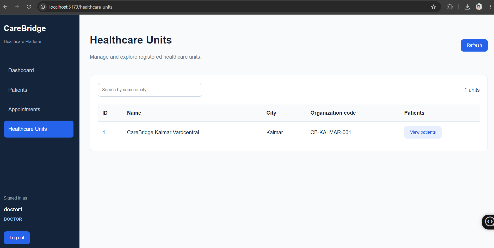
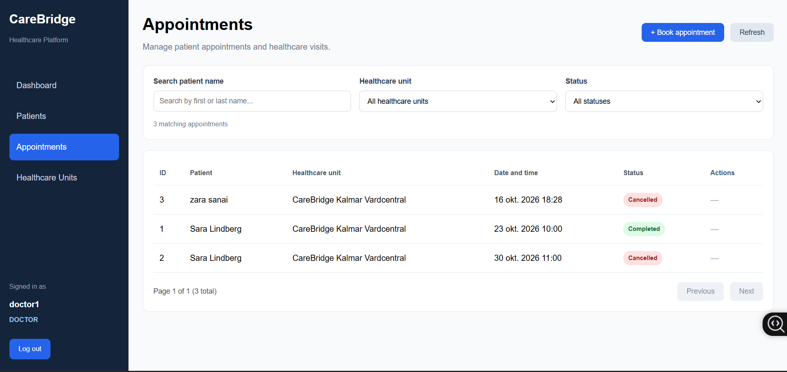
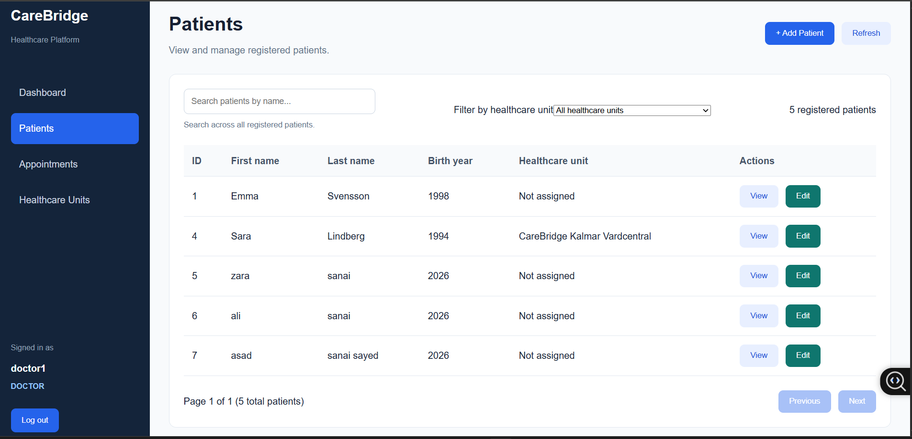
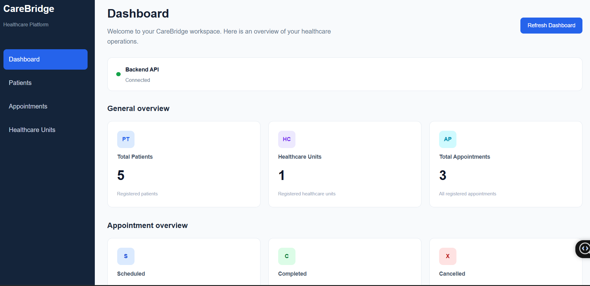

# CareBridge

**A full stack healthcare management demo built with Java, Quarkus, PostgreSQL, Vue 3, TypeScript, and Keycloak.**

CareBridge is a portfolio project exploring how a healthcare administration platform can manage patients, healthcare units, and appointments through a secured REST API and a web interface. It demonstrates full-stack development, relational data modeling, authentication, role-based authorization, database migrations, and automated testing.

> **Demo project:** CareBridge uses fictional test data. It is not a certified medical system and must not be used to store real patient or medical information.

## Features

- **Patient management:** Create, view, update, search, filter, and paginate patient records. Authorized administrators can delete patients.
- **Healthcare units:** Manage healthcare unit information and associate patients with units.
- **Appointments:** Schedule visits, view bookings, and change scheduled appointments to `COMPLETED` or `CANCELLED`.
- **Appointment search:** Filter by patient name, healthcare unit, and status, with server-side pagination.
- **Dashboard:** View counts for patients, healthcare units, and appointments by status.
- **Security:** Sign in with Keycloak; the backend enforces role-based permissions for `ADMIN`, `DOCTOR`, and `NURSE`.
- **Testing:** Automated backend tests cover patient and appointment workflows, filtering, pagination, validation, and authorization.

## Tech stack

| Layer | Technology |
| --- | --- |
| Backend | Java 21, Quarkus, REST APIs, Hibernate ORM with Panache |
| Database | PostgreSQL, Flyway migrations |
| Authentication and authorization | Keycloak, OpenID Connect, role-based access control |
| Frontend | Vue 3, TypeScript, Vite, Vue Router |
| Testing | JUnit 5, REST Assured, Quarkus Test, Quarkus Test Security |
| Version control | Git and GitHub |

## Repository structure

```text
CareBridge/
├── carebridge-api/       # Quarkus backend, database migrations and tests
├── carebridge-web/       # Vue frontend
├── .gitignore
└── README.md
```

## Architecture

```text
Vue 3 / TypeScript frontend (localhost:5173)
                |
                | Authenticated HTTP requests (Bearer token)
                v
Quarkus REST API (localhost:8080) <----> Keycloak (localhost:8180)
                |
                v
        PostgreSQL database
                ^
                |
       Flyway SQL migrations
```

The frontend obtains access tokens through Keycloak. The Quarkus backend validates access and enforces permissions independently of the interface. PostgreSQL stores patient, healthcare-unit, and appointment data, and Flyway tracks database schema changes.

## Role-based permissions

| Action | ADMIN | DOCTOR | NURSE |
| --- | :---: | :---: | :---: |
| View patients and appointments | Yes | Yes | Yes |
| Create or update patients | Yes | Yes | No |
| Delete patients | Yes | No | No |
| Create appointments | Yes | Yes | No |
| Complete or cancel appointments | Yes | Yes | No |

These are the permissions implemented in the patient and appointment APIs; this table is not a claim of production-grade security or compliance.

## Getting started (local development)

### Prerequisites

- Java 21 and Maven
- Node.js and npm
- PostgreSQL
- Keycloak

### 1. Clone the project

```bash
git clone https://github.com/hossein2551/CareBridge.git
cd CareBridge
```

### 2. Configure PostgreSQL

Create the development and test databases expected by your local Quarkus configuration. Review `carebridge-api/src/main/resources/application.properties` for the configured database name, username, host, and test profile before running the application.

Do not commit database passwords. In PowerShell, you can set the password for the current terminal session without displaying it:

```powershell
$securePassword = Read-Host "PostgreSQL password" -AsSecureString
$env:QUARKUS_DATASOURCE_PASSWORD = (New-Object System.Net.NetworkCredential("", $securePassword)).Password
```

### 3. Configure Keycloak

Start Keycloak locally on `http://localhost:8180` and configure the development realm `carebridge` and the public client `carebridge-web` with PKCE. Set appropriate redirect URLs for `http://localhost:5173`, and configure the `ADMIN`, `DOCTOR`, and `NURSE` realm roles. Ensure your backend's OIDC configuration matches the Keycloak realm and client settings.

**Note:** This repository does not currently include an automated Keycloak setup or a one-command deployment configuration; local service configuration is required.

### 4. Start the backend

From a terminal with the PostgreSQL password environment variable set:

```powershell
cd carebridge-api
mvn quarkus:dev
```

The local API is expected at `http://localhost:8080`. Flyway applies pending database migrations during startup when configured accordingly.

### 5. Start the frontend

In a second terminal at the repository root:

```powershell
cd carebridge-web
npm install
npm run dev
```

Open `http://localhost:5173` and sign in with a development Keycloak account.

## Example REST endpoints

| Method | Endpoint | Purpose |
| --- | --- | --- |
| GET | `/api/patients` | List patients |
| GET | `/api/patients/filter/page` | Search and filter patients with pagination |
| GET | `/api/healthcare-units` | List healthcare units |
| GET | `/api/appointments` | List appointments |
| GET | `/api/appointments/filter/page` | Search and filter appointments with pagination |
| GET | `/api/appointments/{id}` | Get an appointment |
| POST | `/api/appointments` | Schedule an appointment |
| PATCH | `/api/appointments/{id}/status` | Complete or cancel a scheduled appointment |

Example appointment filters:

```text
GET /api/appointments/filter/page?patientName=Sara&status=COMPLETED&page=0&size=10
```

Endpoints are protected according to the backend's authorization rules.

## Testing

Run the backend test suite from `carebridge-api` after configuring the test database and required environment variables:

```powershell
mvn test
```

Run the frontend production build from `carebridge-web`:

```powershell
npm run build
```

The backend tests use a separate PostgreSQL test database (`carebridge_test_db`). Do not point the test configuration at a database containing real or valuable data.

## Current scope and limitations

CareBridge is intended as a learning and portfolio project. It does not provide electronic health record functionality, clinical decision support, full audit logging, production deployment automation, or a completed privacy/compliance assessment. Appointment status and date/time handling are simplified compared with a production scheduling system. Real-world deployments would require additional work on security, privacy, auditability, accessibility, resilience, and operations.

## Project goals

CareBridge was developed to practice end-to-end software engineering: designing domain models and APIs, persisting relational data, securing backend operations, building usable frontend workflows, and validating behavior with automated tests.

---

## Application Screenshots

The following screenshots demonstrate the CareBridge user interface and its main features. All patient data shown is fictional and used for demonstration purposes.

### Dashboard

Overview of registered patients, healthcare units, appointments, and appointment statuses.



### Patient Management

Patient registry with search, healthcare unit filtering, pagination, and patient management.



### Appointment Management

Appointment booking and management with patient search, filtering, pagination, and status tracking.



### Healthcare Units

Healthcare unit directory with search and patient relationships.



